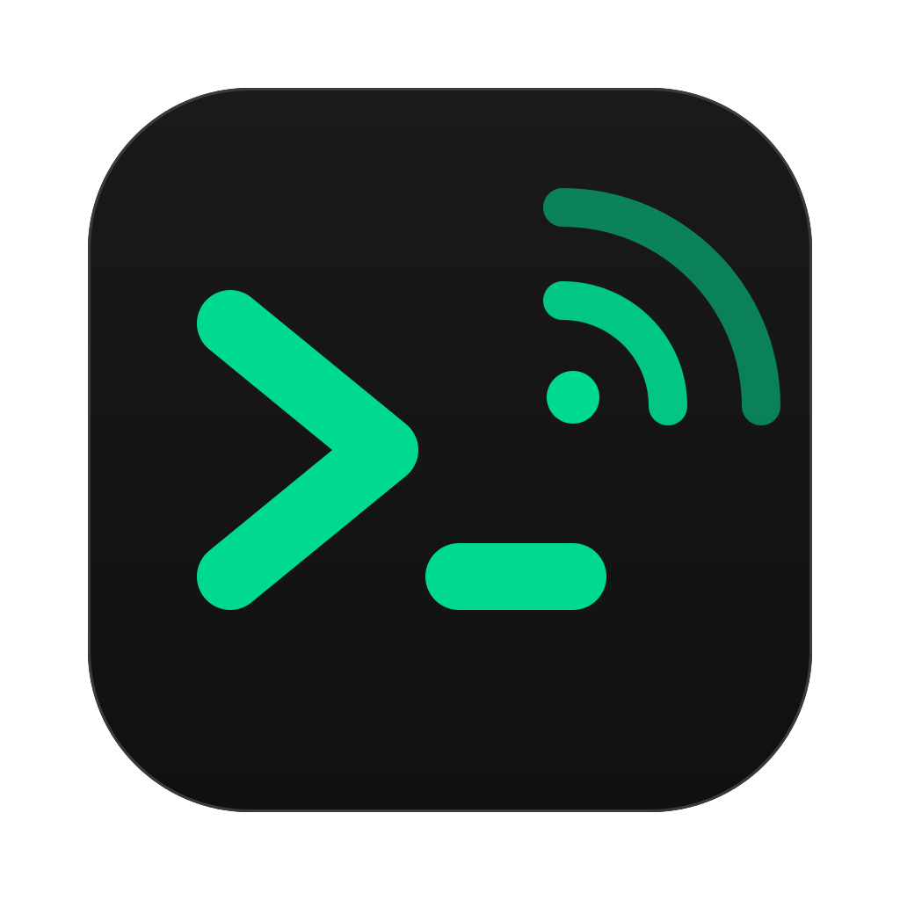

<p align="center"></p>

# CmdTrigger

Your own commands and automations, run from anywhere. You don't need a third-party account;
everything runs on your computers and your own server.

- **On each computer**, the CmdTrigger app runs the commands you define. On machines without a
  screen, the `cmdtrigger` CLI does the same. Commands can be triggered by:
  - **Siri and the Home app**: a built-in HomeKit bridge;
  - **Home Assistant**: entities appear by themselves through MQTT discovery;
  - **webhooks** and a **local HTTP API**;
  - **AI assistants** over MCP;
  - **schedules** and **system events**: startup, wake, joining a network, a USB device, a
    display, a file changing.
- **Automations** chain steps (commands, shell lines, waits, Wake-on-LAN, notifications) with
  conditions (network, time of day, weekdays).
- **The iPhone app** runs your computers' commands and routines from your phone and wakes a
  sleeping Mac. At home it talks to the computer directly over Wi-Fi, end-to-end encrypted;
  away from home it goes through your server. Siri and Shortcuts can use it too.
- **Your own server** (Docker + Caddy) lets you run commands on any of your computers from your
  phone, from anywhere. It has a web dashboard, API tokens for iPhone Shortcuts, Siri and
  scripts, run history with output, and one MCP endpoint for all your computers.

It started as a Rust rebuild of the TRIGGERcmd agent (the reverse-engineering notes are in
[docs/triggercmd-reference.md](docs/triggercmd-reference.md)). It has since become a
standalone system, and nothing talks to triggercmd.com.

| part | what it is | where |
| --- | --- | --- |
| **App** | tray app + window: Commands, Automations, Activity, Settings | `src-tauri/` + `src/` |
| **iPhone app** | SwiftUI: your computers' commands and routines, Wake, activity, Siri & Shortcuts | `ios/` |
| **CLI** | the same agent without a window, plus `run`, `list`, `mcp`, `pair`, `connect`, `wake` | `crates/cmdtrigger-cli/` |
| **Server** | your relay: accounts, computers, dashboard, API tokens, MCP | `crates/cmdtrigger-server/` + `deploy/` |
| **Core** | runner, automations, HomeKit, MQTT, local API, server link | `crates/cmdtrigger-core/` |
| **Protocol** | the agent ⇄ server ⇄ client contract, plus MCP helpers | `crates/cmdtrigger-protocol/` |

## How to run (developers)

### What you need

- [Rust](https://rustup.rs) 1.88+ (edition 2024). If `cargo` isn't found:
  `export PATH="$HOME/.cargo/bin:$PATH"`.
- Node.js 20.19+ or 22.12+.
- Linux only: `libwebkit2gtk-4.1-dev` and `libayatana-appindicator3-dev`.

### The app

```sh
npm install
npm run tauri dev          # the window opens on first run; after that the app lives in the menu bar
```

Data lives in `~/Library/Application Support/CmdTrigger` (macOS), `%APPDATA%\CmdTrigger`
(Windows) or `~/.config/cmdtrigger` (Linux). To run a second copy on separate data:
`CMDTRIGGER_DATA_DIR=/tmp/ct npm run tauri dev`.

#### Deploy

```sh
npm run tauri build
```

This builds the following in `target/release/bundle/`:
- macOS: `CmdTrigger.app` and a `.dmg`;
- Windows: `.msi` and `-setup.exe`;
- Linux: `.deb`, `.rpm` and an AppImage.

- **Where to build:** each platform builds on its own OS, or in CI (`.github/workflows/ci.yml`).
- **macOS signing:** builds are ad-hoc signed. This Mac's Apple team is a free Personal Team, so
  there's no Developer ID or notarization. The first time, right-click the app → **Open**.
- **Start at login:** installed builds start at login. You can turn that off in Settings →
  General.

### The iPhone app

Open `ios/CmdTrigger.xcodeproj` in Xcode and run it on a simulator, which shares this Mac's
network, so it finds a CmdTrigger running here.

Then pair it:
1. In the Mac app, go to **Settings → iPhone → Pair an iPhone**.
2. In the iPhone app, tap **Pair a computer**, pick the Mac, and type the code. On a real
   iPhone, you can also scan the QR code with the Camera app.

On a computer without a screen, run `cmdtrigger pair` instead, which shows the QR code in the
terminal.

### The server, locally

```sh
cargo run -p cmdtrigger-server        # http://127.0.0.1:8080, database ./cmdtrigger-server.db
```

1. Open http://127.0.0.1:8080 and create your account. Only the first account can sign up by
   default.
2. Connect a computer. In the app, use **Settings → Your server** with
   `http://127.0.0.1:8080`. On a headless machine, run
   `cmdtrigger connect http://127.0.0.1:8080 --email you@example.com`.

### Tests and checks

```sh
cargo test --workspace                          # unit + end-to-end tests
cargo test -p cmdtrigger-server                 # real agent ⇄ real server: runs, tokens, MCP, offline, removal
cargo test -p cmdtrigger-core --test homekit    # HomeKit pairing and lights with a test controller
cargo clippy --workspace --all-targets          # zero warnings
cargo fmt --all
npx tsc --noEmit                                # the UI
npm run check:linux      # Debian in Docker: everything, a .deb, and a server + app + service smoke run
npm run check:windows    # Windows build and clippy, core tests under Wine
ios/ui-test.sh           # the iPhone app in the simulator against a real agent + server: pair, run, server, wake
xcodebuild -project ios/CmdTrigger.xcodeproj -scheme CmdTrigger \
  -destination 'platform=iOS Simulator,name=iPhone 17' -only-testing:CmdTriggerTests test   # crypto vs. Rust vectors
```

## Deploy to production

### Your server (any machine with Docker and a domain)

Point the domain's DNS at the machine first, then:

```sh
cd deploy
cp .env.example .env                     # set CMDTRIGGER_DOMAIN=cmd.example.com
docker compose up -d --build             # the server behind Caddy, with automatic HTTPS
```

Open `https://cmd.example.com` and create your account. Data lives in the `server-data` volume
(one SQLite file).

Admin commands:

```sh
docker compose exec server cmdtrigger-server list-users
docker compose exec -it server cmdtrigger-server reset-password you@example.com
docker compose exec server cmdtrigger-server delete-user someone@example.com
```

`CMDTRIGGER_ALLOW_SIGNUP` in `.env` controls who can sign up: empty means only the first
account, `true` means anyone, `false` means nobody.

### The iPhone app, on your iPhone

```sh
ios/build-ipa.sh --install     # with the iPhone connected by USB, unlocked, Developer Mode on
```

This Mac's Apple team is a free Personal Team, which limits how the app can be installed:
- **Installing:** it's signed for iPhones registered with the team (the script registers the
  connected one). There's no TestFlight or App Store.
- **The 7-day limit:** the app stops opening after 7 days. Run the script again to reinstall.
- **Trusting the developer:** the first time, go to Settings → General → VPN & Device
  Management on the iPhone and trust the developer.

### Headless computers (servers, Raspberry Pi)

```sh
cargo build --release -p cmdtrigger-cli && sudo install target/release/cmdtrigger /usr/local/bin/
cmdtrigger connect https://cmd.example.com --email you@example.com   # optional: link to your server
sudo cmdtrigger --install-daemon     # systemd unit "cmdtriggeragent": background commands at boot
cmdtrigger                           # or run the agent in a terminal
```

- **Removing the service:** `sudo cmdtrigger --remove-daemon`.
- **Windows:** the tray menu's **Background Service → Install** does the same, with a UAC prompt.
- **macOS** has no background service; the app starts at login instead.

## What it does

### Commands

- **What a command has:**
  - a name and a shell command;
  - an optional off command;
  - whether it takes parameters, and whether they're quoted;
  - a description, which AI assistants and the dashboard show;
  - an emoji icon;
  - whether it runs in the app or in the background service.
- **How it runs:** through `/bin/sh -c`, or `cmd.exe /c` on Windows. Each run gets these
  environment variables:
  - `CMDTRIGGER_RUN_ID`;
  - `CMDTRIGGER_SOURCE`, such as `homekit`, `mqtt`, `webhook`, `server/api`, `mcp`, `schedule`;
  - `CMDTRIGGER_PARAMS`.
- **Parameters** are appended to the command, unless it uses `CMDTRIGGER_PARAMS` itself. "off"
  runs the off command and "on" runs the command.
- **Editing:** use the form, or edit the JSON directly; it's validated before saving. In the form,
  **Open an app** lists the installed apps and fills in the command, and clicking
  `$CMDTRIGGER_PARAMS` puts it at the cursor.
- **Examples:** a built-in list per OS covers volume, media keys, Shortcuts, lock, sleep,
  shutdown, opening apps and Wake-on-LAN.

### Automations

- **Triggers:**
  - a time of day on chosen weekdays;
  - every N minutes;
  - app start (or boot, for the service);
  - wake from sleep;
  - joining or leaving a network;
  - a USB device plugged in or out, with a name filter;
  - a display connected or disconnected;
  - a file or folder changing;
  - a webhook.
- **Networks** are recognized by their Wi-Fi name. Where macOS hides Wi-Fi names, the router's
  address is used instead. "This network" fills in the current one.
- **Conditions:** on or off a network, between two times, on certain weekdays.
- **Steps:**
  - run a command, with parameters (`{params}` stands for the automation's own);
  - run a shell line;
  - wait;
  - send Wake-on-LAN;
  - show a notification.
- **Failures:** each automation either stops at the first failed step or keeps going.
- **Running by hand:** every automation can also be run from the app, the tray, HomeKit, Home
  Assistant, your server, the API or an AI assistant. Runs started this way skip the
  conditions.

### The iPhone app

- **Home screen:** each computer shows how it's reachable ("Home Wi-Fi", "Via server",
  "Asleep"), its routines (automations) and commands as tiles, and a **Wake** button.
- **Running things:** tap a tile to run it. Items with parameters or on/off ask first. A failed
  run shows its output.
- **Activity** lists every run from every source, with output.
- **Siri and Shortcuts:** "Run a Command or Routine" and "Wake a Computer" actions, with
  phrases like "Hey Siri, CmdTrigger Morning". You can chain them in your own shortcuts and
  automations (an alarm, arriving home).
- **Pairing:**
  - The computer shows a one-time code as a QR code and as text (16 characters, 80 bits,
    5 minutes).
  - Both sides prove they know the code without sending it, then derive a per-phone key from
    an X25519 exchange.
  - Every call after that is ChaCha20-Poly1305 sealed, timestamped and replay-checked.
  - Phones are listed (and removable) in the Mac's Settings → iPhone.
- **Finding the computer:** by Bonjour (`_cmdtrigger._tcp`, port 7180), or at its last
  address.
- **Away from home:** sign in to your server in the app's Settings. The phone keeps an API
  token, not your password.

### Waking your Mac from the iPhone

- **When it's awake:** **Screen on** turns the display on.
- **When it's asleep:** the phone sends Wake-on-LAN magic packets straight to the Mac's own
  address. iOS doesn't let a free-team app broadcast, so it can't use the usual broadcast
  packet. The phone also connects to the Mac's CmdTrigger port, which wakes it through a
  Bonjour Sleep Proxy (an Apple TV or HomePod) when the home has one. Either way, it keeps
  trying for 45 seconds, and once the Mac answers it turns the screen on.
- **What the Mac needs:**
  - "Wake for network access" on (the Mac's Settings → iPhone shows it, and can turn it on);
  - the phone on the same Wi-Fi;
  - power: a MacBook on battery sleeps too deeply.
- **Shut down:** a shut-down Mac can't be started over the network; only a sleeping one can be
  woken.

### Ways in

- **Tray:** the Run menu has every command and automation; ones that take parameters ask
  first. The server status is shown too.
- **HomeKit:** a native bridge on port 47129, advertised over mDNS, with SRP pairing and
  encrypted sessions.
  - Every item is a light, so Siri can run it: "Hey Siri, turn on Living room TV".
  - Off runs the off command, and brightness becomes the parameter.
  - Pairing and accessory IDs persist.
- **Home Assistant:** through the MQTT integration (for example, the Mosquitto add-on).
  - There is one device per computer. Every item becomes a button; items with an off command
    also get a switch, and items that take parameters get a text entity.
  - Stale entities are removed, and the device shows as unavailable when the app stops.
- **Local API** on `127.0.0.1:7171`, optionally open to the LAN, with a key:
  - `GET /api/v1/catalog`;
  - `POST /api/v1/run`, which waits and returns the output;
  - `GET /api/v1/runs`;
  - webhooks at `/hooks/<id>`. They need no key, and the automation's conditions apply.
- **AI assistants (MCP):**
  - `cmdtrigger mcp` (stdio) offers this computer's commands and automations as tools. For
    Claude Code, Settings → API & AI shows the exact `claude mcp add` line.
  - The server's `/api/v1/mcp` endpoint covers all your computers.
- **Your server:**
  - **Runs:** with an API token, `POST /api/v1/run {computer, target, params, wait}` runs
    anything on any computer. iPhone Shortcuts, and so Siri, can call it.
  - **Dashboard:** a phone-friendly page you can add to your home screen. It shows your
    computers with their online status, one tap per item, and run history with output.
  - **Credentials:** agents keep only a computer token. Your password is used once, to
    register the computer.
- **iPhone (phone link):** port 7180 on the LAN, only for paired phones, sealed end to end.
  Only the app (or `cmdtrigger console`) serves it; it reaches the background service's
  commands through its local API.
- **CLI:**
  - `cmdtrigger run NAME [PARAMS]` goes through the running app when there is one;
  - `cmdtrigger pair` shows a QR code to pair an iPhone, for computers without a screen;
  - `list`, `mcp`, `connect`, `disconnect` and `wake MAC`.

### Activity

Every run from every source, live, with output, exit code and duration. The last 500 are kept
in `history.jsonl`, and **Clear** empties it.

### Other

- Wake-on-LAN: this computer's MAC addresses are in Settings → General.
- Seven languages for the tray menu.
- Start at login.
- If you used the TRIGGERcmd agent before, your commands are imported once from
  `~/.TRIGGERcmdData`.

## Follow-ups

- [ ] Wake the real Mac from the real iPhone: sleep it with "Wake for network access" on, and
      tap Wake on the same Wi-Fi. The packets and the retry loop are tested in the simulator
      (`ios/ui-test.sh`), not against sleeping hardware.
- [ ] iPhone widgets and Control Center buttons for favourite routines.
- [ ] The phone link on a real Windows PC. It builds and lints for Windows, but its end-to-end
      tests (listener + mdns-sd Bonjour) only run on macOS and Linux; under Wine the
      advertiser crashes.

- [ ] Pair with the Home app on a real iPhone. So far it's verified with an independent HAP
      controller (`hap-controller`): discovery, pairing, reads, writes, events and pairings.
- [ ] Try Home Assistant with a real MQTT broker. The discovery layout is unit-tested, but no
      broker has been connected yet.
- [ ] Deploy the server to a domain and use the dashboard from a phone.
- [ ] Windows on a real machine: service install, UAC, tray. The cross-compile and the core
      tests under Wine pass.
- [ ] Translate the window. The tray is translated; most window text is English.
- [ ] Push to GitHub so CI runs.
